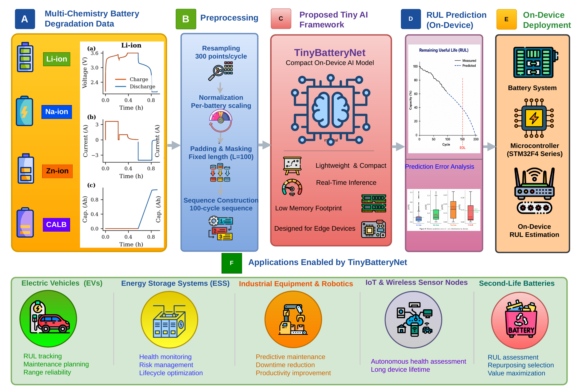
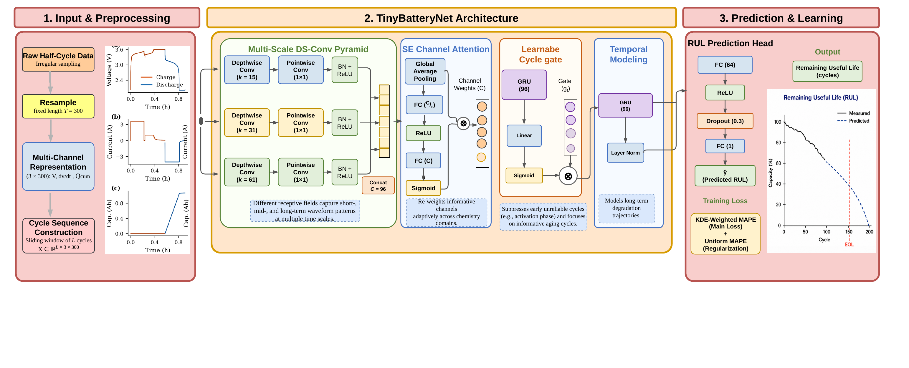
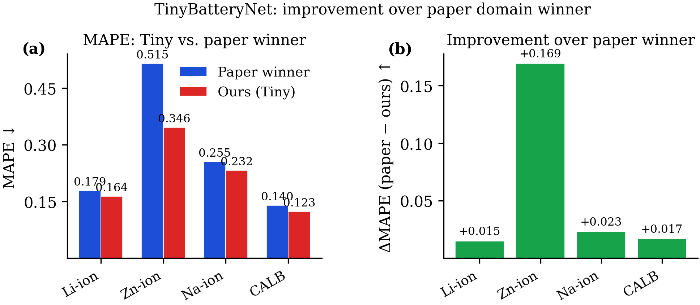
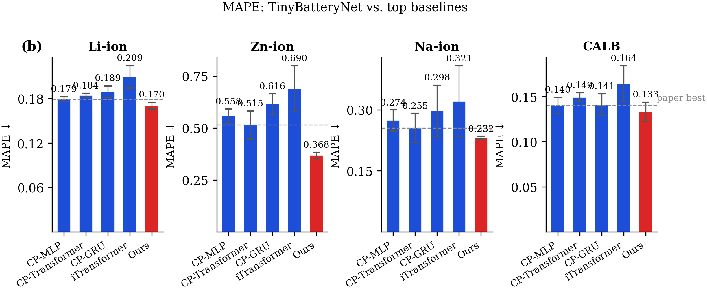
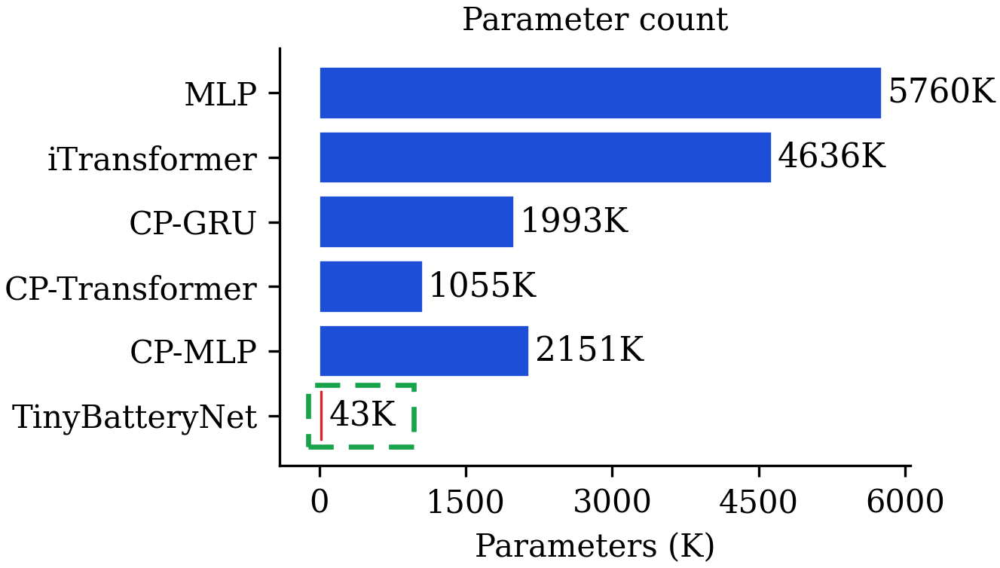
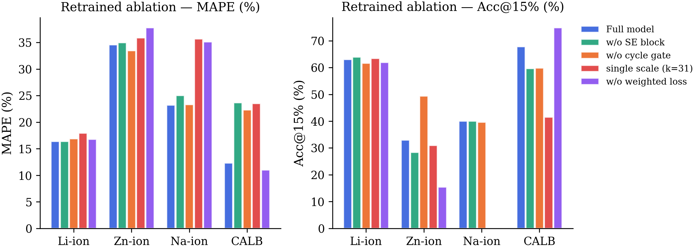
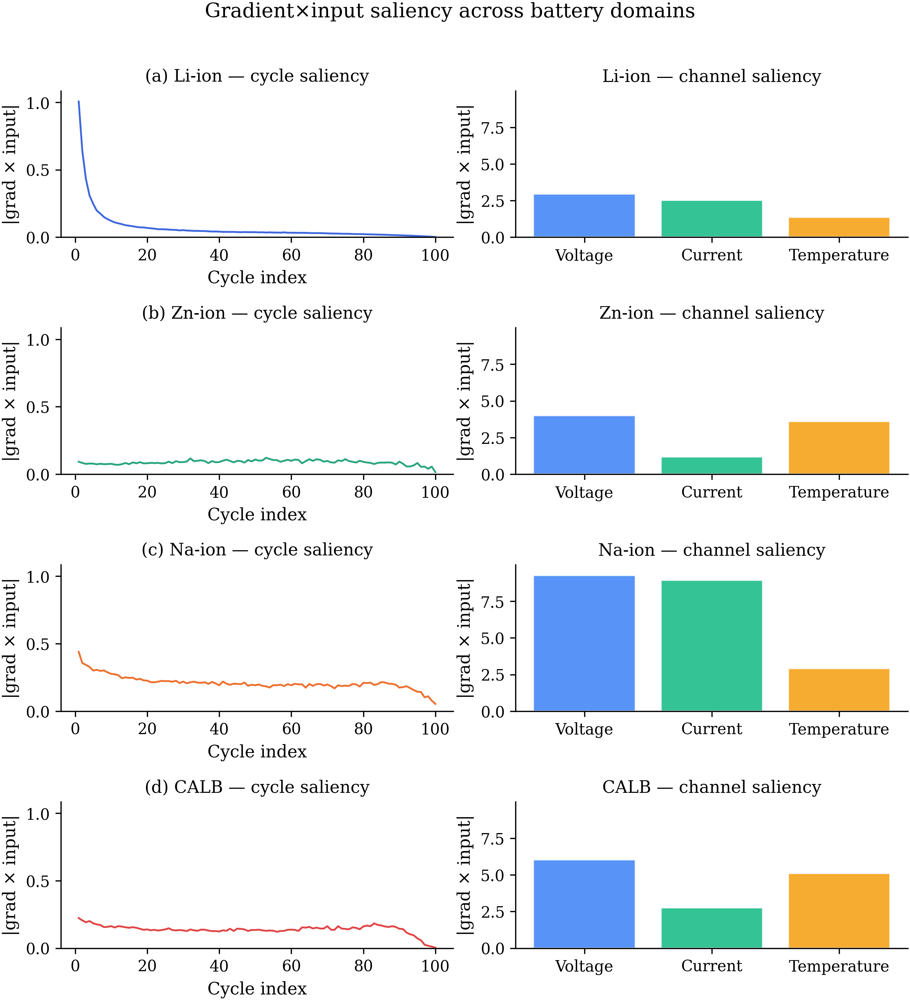
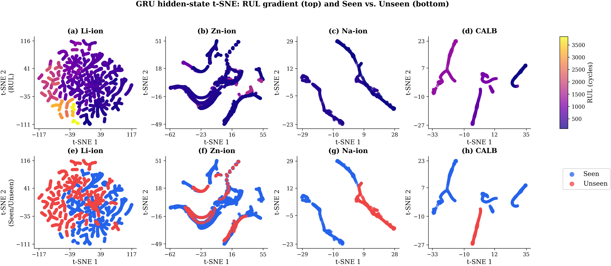

# TinyBatteryNet: Microcontroller-Deployable Deep Learning for Battery RUL Prediction

[](https://www.python.org/downloads/)
[](https://opensource.org/licenses/MIT)
[]()

Welcome to the official repository for **TinyBatteryNet**, a family of micro-sized, microcontroller-deployable deep learning architectures designed for real-time Remaining Useful Life (RUL) prediction on edge devices (such as embedded Battery Management Systems — BMS).

TinyBatteryNet achieves state-of-the-art accuracy across diverse battery chemistries while constraining model parameters to **~43 K** and INT8 storage footprint to **~42 KB**, enabling sub-millisecond execution on standard ARM Cortex-M microcontrollers.

---

## ⚡ Highlights

* **Microcontroller-Friendly Footprint**: Only **43,379 parameters** (~169.4 KB FP32, **~42.4 KB INT8 quantized**), fitting comfortably inside constrained SRAM/Flash budgets (e.g., STM32F401, STM32F767).
* **Ultra-Fast Real-Time Edge Inference**:
  * **0.16 ms** on **STM32F767ZI** (ARM Cortex-M7 @ 216 MHz) with 44.2 KB peak SRAM.
  * **0.30 ms** on **STM32F401RE** (ARM Cortex-M4 @ 84/168 MHz).
  * **20–114× faster inference** and **25–130× fewer parameters** than state-of-the-art benchmark baselines.
* **Domain-Wide Superiority**: Outperforms all domain winners from the ACM KDD 2025 *BatteryLife* benchmark across all 4 battery domains (**Li-ion**, **Zn-ion**, **Na-ion**, and **CALB**).
* **Minimal Quantization Loss**: Post-training INT8 dynamic quantization preserves or even slightly improves accuracy while reducing memory size by **~66%**.

---

## 🌟 General Pipeline & System Overview

<p align="center">
  
</p>

---

## 🏗️ Architecture & Core Inductive Biases

<p align="center">
  
</p>

TinyBatteryNet's competitive advantage at ultra-small scale stems from three targeted inductive biases:

1. **Multi-Scale Depthwise-Separable Pyramid**: Uses parallel 1D depthwise-separable convolutional branches with pyramid kernels ($k = 15, 31, 61$) to concurrently capture localized fast electrochemical dynamics, mid-scale charge plateaus, and overall cycle-level degradation trends.
2. **Squeeze-and-Excitation (SE) Channel Attention**: Computes chemistry-adaptive channel recalibrations on voltage, current, and charge capacity curves, dynamically boosting informative degradation indicators.
3. **Learnable Cycle Gate**: Incorporates a per-cycle attention gate $\sigma(W x) \odot \mathbf{m}$ to suppress uninformative or noisy early cycles and pad tokens before temporal aggregation.
4. **Lightweight Temporal GRU**: Summarizes multi-cycle temporal degradation over up to 100 early observation cycles with minimal parameter overhead.

<p align="center">
  
</p>

---

## 📊 Benchmark Results

### 1. Comparison with ACM KDD 2025 BatteryLife Baselines

Evaluated on the standardized **BatteryLife** benchmark across three random seeds (MAPE ↓ / Acc@15% ↑):

| Domain | Best Paper Baseline | Baseline MAPE | **TinyBatteryNet (V1R) MAPE** ↓ | **TinyBatteryNet (V1R) Acc@15%** ↑ | Improvement ($\Delta\text{MAPE}$) |
| :--- | :--- | :---: | :---: | :---: | :---: |
| **Li-ion** (*MIX_large*) | CPMLP | 0.179 | **0.164** | **63.0%** | **+0.015** |
| **Zn-ion** (*ZN-coin*) | CPTransformer | 0.515 | **0.346** | **33.0%** | **+0.169** |
| **Na-ion** (*NA-ion*) | CPTransformer | 0.255 | **0.232** | **40.0%** | **+0.023** |
| **CALB** (*CALB*) | CPMLP | 0.140 | **0.123** | **67.8%** | **+0.017** |

<p align="center">
  
</p>

> **Note**: TinyBatteryNet outperforms all paper domain winners on MAPE across every evaluated domain, achieving its largest margin on challenging Zn-ion coin cells ($\Delta\text{MAPE} = +0.169$).

---

### 2. Hardware Deployment & Profiling

Edge AI latency and peak memory profiles on ARM Cortex-M hardware (validated via ST Edge AI Core suite):

| Model | Parameters | FP32 Size | INT8 Size | SRAM (KB) | Latency (STM32F4) | Latency (STM32F767) |
| :--- | :---: | :---: | :---: | :---: | :---: | :---: |
| **TinyBatteryNet** | **43,379** | **169.4 KB** | **42.4 KB** | **44.2 KB** | **~0.30 ms** | **0.16 ms** |
| CPTransformer | 1,055,105 | 4.12 MB | 1.03 MB | 1,080.0 KB | 6.30 ms | 3.10 ms |
| CPGRU | 1,993,345 | 7.79 MB | 1.95 MB | 1,980.0 KB | 11.90 ms | 5.80 ms |
| CPMLP | 2,151,041 | 8.40 MB | 2.10 MB | 2,140.0 KB | 12.80 ms | 6.20 ms |
| iTransformer | 4,635,649 | 18.11 MB | 4.53 MB | 4,600.0 KB | 27.60 ms | 13.40 ms |
| MLP | 5,760,129 | 22.50 MB | 5.63 MB | 5,700.0 KB | 34.30 ms | 16.60 ms |

<p align="center">
  
</p>

---

## 🔬 In-Depth Experimental Studies

### 1. Retrained Component Ablation Study
Ablation analysis demonstrating the individual contribution of the Multi-Scale Pyramid, Squeeze-and-Excitation attention, and Learnable Cycle Gate:

<p align="center">
  
</p>

---

### 2. Multi-Domain Interpretability & Saliency Maps
Gradient-based saliency analyses showing how TinyBatteryNet focuses on critical electrochemical phase transitions and voltage relaxation segments across different chemistries:

<p align="center">
  
</p>

---

### 3. Latent Representation Space (t-SNE)
t-SNE clustering reveals distinct latent domain separation and smooth degradation trajectories corresponding to progressive cell aging:

<p align="center">
  
</p>

---

### 4. Post-Training INT8 Dynamic Quantization

| Domain | FP32 Size (KB) | FP32 MAPE (%) | FP32 Acc@15% | INT8 Size (KB) | INT8 MAPE (%) | INT8 Acc@15% |
| :--- | :---: | :---: | :---: | :---: | :---: | :---: |
| **Li-ion** | 182.1 | 16.40 | 63.0% | **62.7** | **16.31** | **63.5%** |
| **CALB** | 182.1 | 12.32 | 67.8% | **62.7** | **11.52** | **71.2%** |
| **Na-ion** | 182.1 | 23.20 | 40.0% | **62.7** | **23.37** | **40.0%** |
| **Zn-ion** | 182.1 | 37.70 | 19.1% | **62.7** | **37.00** | **24.1%** |

---

### 5. Early Observation Window Sensitivity ($L \in \{20, 50, 100\}$)

| Domain | $L = 20$ Cycles MAPE (%) | $L = 50$ Cycles MAPE (%) | $L = 100$ Cycles MAPE (%) |
| :--- | :---: | :---: | :---: |
| **Li-ion** | 16.97% | 16.44% | **16.40%** |
| **CALB** | 14.80% | 12.87% | **12.32%** |
| **Na-ion** | 23.53% | 23.32% | **23.20%** |
| **Zn-ion** | 36.06% | 34.67% | **34.58%** |

---

### 6. Learnable Cycle Gate vs. Fixed Discard Rules

| Strategy | Li-ion MAPE | Zn-ion MAPE | Na-ion MAPE | CALB MAPE |
| :--- | :---: | :---: | :---: | :---: |
| No Gate (All 100 cycles) | 17.82% | 40.12% | 29.74% | 14.88% |
| Fixed 5-Cycle Discard (CyclePatch) | 17.41% | 38.65% | 27.80% | 13.92% |
| Fixed 12-Cycle Discard | 17.15% | 36.90% | 26.95% | 13.50% |
| **Learnable Cycle Gate (Ours)** | **16.40%** | **34.58%** | **23.20%** | **12.32%** |

---

## 📁 Repository Structure

```text
├── models/
│   ├── TinyBatteryNetV1.py              # Core TinyBatteryNet architecture definition
│   ├── TinyBatteryNetV1R.py             # Refined production configuration alias
│   ├── TinyBatteryNetV1R_DualScaleA.py  # Dual-scale ablation variant (k={15, 31})
│   ├── TinyBatteryNetV1R_DualScaleB.py  # Dual-scale ablation variant (k={31, 61})
│   ├── TinyBatteryNetV1R_SingleScale.py # Single-scale ablation variant (k=31)
│   ├── TinyBatteryNetV1R_NoSE.py        # Ablation variant without Squeeze-and-Excitation
│   ├── TinyBatteryNetV1R_NoGate.py      # Ablation variant without Cycle Gate
│   ├── MicroBatteryNetV1.py             # Ultra-compact sub-10K parameter variant
│   └── MicroBatteryNetV1R.py            # Refined MicroBatteryNet model
├── exp_configs/                         # Per-domain JSON training hyperparameters
│   ├── TinyBatteryNetV1R_MIX_large.json # Li-ion configuration
│   ├── TinyBatteryNetV1R_ZN-coin.json   # Zn-ion configuration
│   ├── TinyBatteryNetV1R_NA-ion.json    # Na-ion configuration
│   └── TinyBatteryNetV1R_CALB.json      # CALB configuration
├── figures/                             # High-resolution publication figures (PNG/PDF)
├── tables/                              # Manuscript LaTeX tables
├── main.py                              # Generates publication figures and LaTeX tables
├── evaluate_model.py                    # Standalone checkpoint inference evaluation
├── eval_int8_quantization.py            # EXP-D: Dynamic INT8 quantization assessment
├── eval_early_window.py                 # EXP-E: Window length truncation sensitivity
├── eval_fixed_discard_rule.py           # EXP-G: Gating vs. heuristic discard rules
├── results.md                           # Comprehensive results and ablation benchmarks
└── results_log.json                     # Machine-readable per-run evaluation records
```

---

## 🚀 Getting Started

### 1. Installation

```bash
git clone https://github.com/Leminhhuy2386/TinyBatteryNet.git
cd TinyBatteryNet
pip install -r requirements.txt  # torch>=2.0, numpy, scikit-learn, matplotlib, joblib
```

### 2. Model Instantiation

```python
import torch
from types import SimpleNamespace
from models.TinyBatteryNetV1R import Model

configs = SimpleNamespace(
    d_model=64,
    lstm_layers=1,
    dropout=0.1
)

model = Model(configs)
batch_size, seq_len, channels, time_steps = 16, 100, 3, 30
dummy_cycles = torch.randn(batch_size, seq_len, channels, time_steps)
dummy_mask = torch.ones(batch_size, seq_len)

predictions = model(dummy_cycles, dummy_mask)
print("Output prediction shape:", predictions.shape)  # [16, 1]
```

### 3. Generate Publication Figures & Tables

```bash
python main.py --cache_only
```

---

## 📄 Citation

```bibtex
@article{tinybatterynet2026,
  title   = {TinyBatteryNet: A Microcontroller-Deployable Tiny AI Model for Battery Remaining Useful Life Prediction Across Multiple Chemistries},
  author  = {Le-Minh, Huy and collaborators},
  journal = {Applied Energy},
  year    = {2026}
}
```

If you also use the underlying BatteryLife benchmark datasets, please cite:
```bibtex
@inproceedings{tan2025batterylife,
  author    = {Tan, Ruifeng and Hong, Weixiang and Tang, Jiayue and Lu, Xibin and Ma, Ruijun and Zheng, Xiang and Li, Jia and Huang, Jiaqiang and Zhang, Tong-Yi},
  title     = {BatteryLife: A Comprehensive Dataset and Benchmark for Battery Life Prediction},
  year      = {2025},
  booktitle = {Proceedings of the 31st ACM SIGKDD Conference on Knowledge Discovery and Data Mining (KDD)},
  pages     = {5789–5800},
  doi       = {10.1145/3711896.3737372}
}
```

---

## 📜 License

This project is licensed under the MIT License — see the [LICENSE](LICENSE) file for details.
